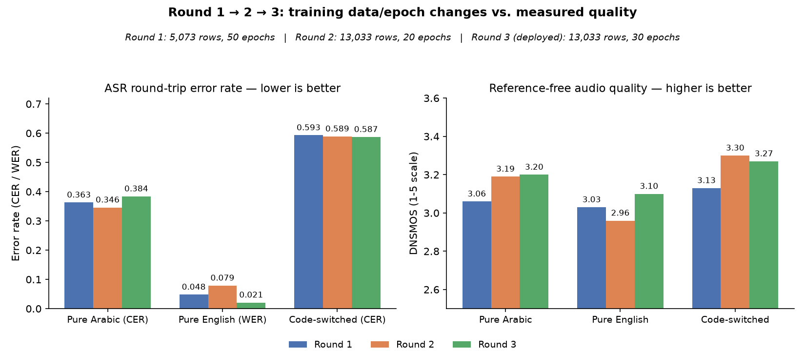

# Hams.AI TTS — Levantine Arabic / English Code-Switching

Low-latency, streaming TTS for Levantine Arabic, English, and natural
code-switching between them. Built on a fine-tuned VITS/MMS-TTS model,
served over a FastAPI WebSocket streaming server and a Pipecat
`TTSService` plugin.

Read `PRD.md` (requirements/acceptance criteria) and `PLAN.md` (build
phases + architecture decisions, including two that changed once real
vendor constraints were in hand) before making non-trivial changes.
`docs/design_doc.md` is the main design writeup (data/phonemization
strategy, model choices, training approach, benchmark results,
limitations). `AGENTS.md` has environment setup details and incident
notes for anyone debugging this repo further.

## Deliverables

| # | Deliverable | Where |
|---|---|---|
| 1 | Model weights on Hugging Face | [huggingface.co/mohammed/hams-tts-levantine](https://huggingface.co/mohammed/hams-tts-levantine) (public) |
| 2 | Code repo: training/fine-tuning, inference, streaming server, benchmark script, Pipecat plugin, README | this repo — `src/hams_tts/training/`, `src/hams_tts/inference/`, `src/hams_tts/server/`, `scripts/benchmark.py`, `src/hams_tts/pipecat_plugin/` |
| 3 | 3 sample WAVs (pure AR, pure EN, code-switched) | `samples/sample_arabic.wav`, `samples/sample_english.wav`, `samples/sample_codeswitch.wav` |
| 4 | Demo video (≤3 min) | shot list + narration ready in `docs/demo_video_script.md`; recording this is the user's remaining step |
| 5 | Design doc (data/phonemization, model/optimization justification, training approach, benchmark results table, limitations) | `docs/design_doc.md` |

Supporting evidence beyond the minimum: `docs/eval_results/` (FR4 ASR
round-trip CER/WER + DNSMOS, plus a 32-file diagnostic set isolating
individual phonemes/dialect-lexicon words for targeted listening),
`docs/eval_results/listener_scoring_template.csv` (MOS-style listening
test template — ready to run with real listeners, not yet run with the
brief's suggested n≥5), `docs/benchmark_results.md` (latest raw
benchmark output), `scripts/websocket_test_client.html` (browser test
client for both the streaming and non-streaming endpoints).

## Training Rounds & Results

Three fine-tuning rounds, each motivated by a specific finding from the
previous one (full reasoning in [design doc §1.1/§4](docs/design_doc.md#11-training-data)):

| Round | Data (ClArTTS / ASC / LJSpeech) | Total rows | Epochs | Pure-Arabic CER | Pure-English WER | Code-switched CER | Arabic DNSMOS | English DNSMOS | Code-switch DNSMOS |
|---|---|---|---|---|---|---|---|---|---|
| 1 | 1,500 / 1,873 / 1,700 | 5,073 | 50 | 0.363 | 0.048 | 0.593 | 3.06 | 3.03 | 3.13 |
| 2 | 9,460 (full) / 1,873 / 1,700 | 13,033 | 20 | 0.346 | 0.079 | 0.589 | 3.19 | 2.96 | 3.30 |
| 3 (deployed) | 9,460 (full) / 1,873 / 1,700 | 13,033 | 30 | **0.384** | **0.021** | **0.587** | **3.20** | **3.10** | **3.27** |

(CER/WER: lower=better. DNSMOS: 1-5, higher=better.)



Round 1 → 2 added the rest of ClArTTS (data diversity) and is what moved
Arabic quality; round 2 → 3 kept that same dataset but trained for more
epochs (convergence depth), which recovered English and held the Arabic/
code-switch gains. Round 3 was also confirmed as an improvement by direct
listening, not just by these metrics — see
[design doc §4](docs/design_doc.md#4-benchmark-results-vs-targets) for
the full listening-feedback writeup, including the two pronunciation bugs
it surfaced and how each was fixed.

## Setup

Requires Python 3.12 and [uv](https://docs.astral.sh/uv/). No system
packages need root — espeak-ng is vendored locally (see below).

```sh
uv sync
```

espeak-ng is not installed system-wide — it's vendored under
`.local-tools/` (extracted from the Ubuntu `.deb` packages with
`apt-get download` + `dpkg-deb -x`, no root required; see `AGENTS.md`
"Environment" for the exact commands used if you need to redo this on a
different machine). `src/hams_tts/text/espeak_setup.py` points
`phonemizer` at it automatically — nothing to export manually.

```sh
uv run pytest tests/ -q
```

## Repo layout

```
src/hams_tts/
  text/              # normalize, diacritize, g2p, levantine_rules, pipeline.py, vocab.py
  training/
    vendor/          # ylacombe/finetune-hf-vits, vendored + patched for transformers 5.x
    data_prep/       # buckwalter.py, codeswitch_templates.py
  inference/
    engine.py        # Engine class — the one place that loads the model
    chunking.py       # clause-boundary chunking for streaming synthesis
  server/            # FastAPI + WebSocket streaming server
  pipecat_plugin/    # Pipecat TTSService subclass
configs/             # training configs for the vendored fine-tuning script
scripts/             # dataset download/prep, vocab building, benchmarking
data/                # raw/processed datasets, checkpoints (gitignored — see below)
docs/design_doc.md   # main design writeup
```

## Reproducing the pipeline end to end

```sh
# Phase 2: fetch + prepare data
uv run python3 scripts/download_datasets.py
uv run python3 scripts/prepare_manifests.py
uv run python3 scripts/build_vocab.py

# Phase 3: fine-tune (run from inside vendor/ — it uses top-level imports)
cd src/hams_tts/training/vendor
uv run --project <repo-root> accelerate launch --num_processes=1 \
  run_vits_finetuning.py ../../../../configs/finetune_hams_levantine.json

# Phase 5: run the server against the trained checkpoint
cd <repo-root>
HAMS_MODEL_DIR=data/processed/checkpoint PYTHONPATH=src \
  uv run uvicorn hams_tts.server.main:app --host 127.0.0.1 --port 8765

# Benchmark (server mode is what the design doc's numbers must come from)
PYTHONPATH=src uv run python3 scripts/benchmark.py --mode server --host 127.0.0.1 --port 8765
```

(`PYTHONPATH=src` is needed because this project isn't installed as a
package — `pyproject.toml` sets `[tool.uv] package = false` deliberately,
see `AGENTS.md`. `pytest` picks `src/` up automatically via
`pyproject.toml`'s `[tool.pytest.ini_options]`; plain script/uvicorn
invocations need it set explicitly.)

`HAMS_MODEL_DIR` / `HAMS_TOKENIZER_DIR` / `HAMS_DEVICE` / `HAMS_SPEAKER_ID`
configure both the server and the Pipecat plugin identically — see
`hams_tts/server/main.py`'s module docstring for the full WebSocket wire
protocol and these env vars' defaults.

## Pipecat integration

```python
import sys
sys.path.insert(0, "src")  # or run with PYTHONPATH=src — see the note above

from hams_tts.pipecat_plugin.hams_tts_service import HamsTTSService

tts = HamsTTSService(default_lang="ar")  # picks up HAMS_MODEL_DIR etc. from env
# ... wire into a Pipecat Pipeline like any other TTSService
```

See the example at the bottom of `hams_tts/pipecat_plugin/hams_tts_service.py`.

## Data/checkpoints

`data/raw/`, `data/processed/`, and trained checkpoints are not committed
to this repo (regenerable via the scripts above; `data/raw/checkpoints/`
in particular re-downloads a large file from the Hub if deleted — see
`AGENTS.md`). Model weights are published separately on Hugging Face:
[mohammed/hams-tts-levantine](https://huggingface.co/mohammed/hams-tts-levantine).
