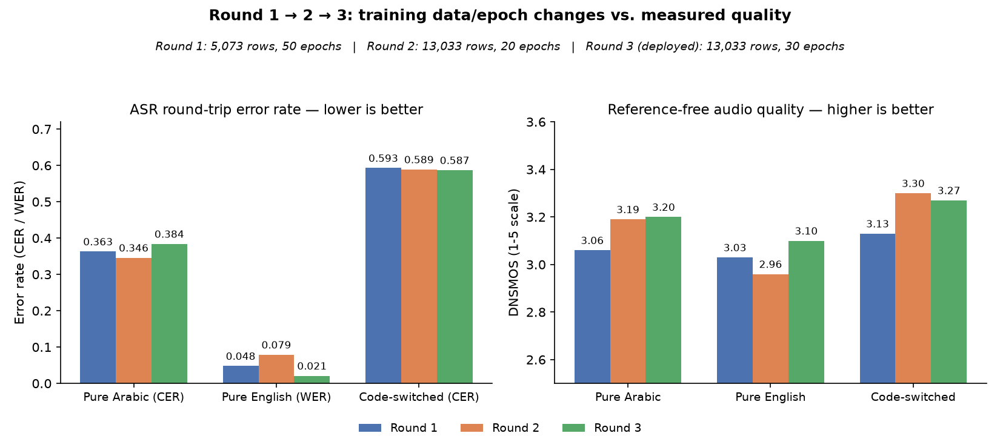

# Design Doc — Low-Latency Levantine Arabic/English Code-Switching TTS

A Hams.AI project. See `PRD.md` for full requirements/acceptance
criteria and `PLAN.md` for the phased build log and architecture-decision
history (including two decisions that changed once real vendor code was in
hand). This doc summarizes the final state; `PLAN.md` has the "why we
changed our mind" detail for anyone auditing the process.

## 1. Data & Phonemization Strategy

### 1.1 Training data

Three HF-hosted parquet-mirror datasets (deliberately avoided the original
script-based dataset repos — `datasets` is deprecating arbitrary
loading-script execution, and the mirrors below give the same content
without that dependency):

| Source | Mirror used | Language/accent | Rows used | License |
|---|---|---|---|---|
| ClArTTS | `MBZUAI/ClArTTS` | MSA, single female speaker, pre-diacritized | 9,460 (all 9,500 available, minus eval holdout) | CC BY 4.0 |
| Arabic Speech Corpus (ASC) | `tunis-ai/arabic_speech_corpus` | Syrian-accented MSA, single male speaker | 1,873 (all 1,913 available, minus eval holdout) | CC BY 4.0 (Nawar Halabi) |
| LJSpeech | `bookbot/ljspeech_phonemes` | American English, single female speaker | 1,700 (of 13,100 available) | Public domain |

ASC's transcripts are Buckwalter transliteration, not Arabic script —
converted via a standard reversible mapping table
(`hams_tts/training/data_prep/buckwalter.py`). Buckwalter happens to be a
lossless transliteration of fully-vocalized text, so this recovers complete
diacritics (tashkeel) for free.

**Final training set: 13,033 utterances (train) / 120 (held out for the
training script's own periodic eval) — roughly 87% Arabic / 13% English by
utterance count.**

**Revision note (round 2):** round 1 capped ClArTTS at 1,500 of its 9,500
rows (~65/35 AR/EN) to bound wall-clock for the first training pass.
Informal listening on that checkpoint found Arabic pronunciation quality
wasn't where it needed to be — a plausible root cause: the custom phoneme
vocabulary (§1.3) means the text encoder's embedding table was
reinitialized from scratch rather than inheriting the pretrained
checkpoint's learned Arabic mappings, so it needs substantially more
phoneme-level exposure than a 1,500-row subset gives it. Round 2 uses the
full ClArTTS corpus (all 9,500 rows) while holding LJSpeech at the same
1,700-row cap — English pronunciation was already near-perfect (§4), so
there was no quality reason to spend additional training time there.
Epoch count was correspondingly reduced from 50 to 20 to keep total
optimizer steps (and wall-clock: ~1h59m, close to round 1's ~1h58m)
comparable despite ~2.6x more rows per epoch — trading repetition count
for data diversity rather than increasing both. This is more AR-heavy
than the original 40/40/20 AR/EN/code-switched target in `PLAN.md` — see
§5 (Limitations).

**Revision note (round 3):** round 2's final KL loss (2.03) was higher
than round 1's (0.81) — expected, since round 2's utterances each saw
fewer passes (20 epochs vs. 50) in exchange for more data, but it meant
round 2 likely hadn't converged as deeply as round 1 had. Round 3 keeps
round 2's full dataset unchanged and raises epochs 20→30 (~3h wall-clock)
to combine both levers — more data *and* adequate convergence depth —
rather than trading them off again. §4 has the three-round comparison.
Net result: round 3 recovered (and slightly exceeded) round 1's English
quality while keeping round 2's Arabic/code-switch gains, but Arabic
DNSMOS itself barely moved between round 2 and round 3 (3.19→3.20) —
more epochs on the *same* corpora appears to have hit diminishing
returns for Arabic specifically. The next lever for further Arabic
improvement is a different/additional corpus, not more epochs on
ClArTTS+ASC, which are now both fully used.

**No code-switched utterances exist in the training set.** No public
corpus of real Levantine-English code-switched *speech* exists (the
premise of the brief's own risk table), and the self-training bootstrap
loop that would generate pseudo-labeled code-switched training data needs
a first working checkpoint before it can run at all. Round-1 training
here is monolingual AR + monolingual EN only; code-switching capability
has to come from the model generalizing across one shared phoneme
vocabulary + language-marker tokens learned from monolingual data, not
from ever having seen matched code-switched audio.

### 1.2 Text pipeline (`src/hams_tts/text/`)

```
segment_mixed_text → normalize_span → diacritize (AR only) → g2p (espeak-ng)
    → levantine_rules → language-marker insertion → join
```

- **`lang_segment.py`**: splits raw text into Arabic/Latin-script spans by
  Unicode codepoint range; digits/punctuation attach to the nearest
  language context rather than forming a disconnected third category.
- **`normalize.py`**: expands numbers, Gregorian dates, and
  currency (USD/EUR/GBP/JOD/SAR/SYP/LBP symbols) into spoken words per
  language (`num2words`), and collapses Arabic/Latin punctuation to one
  canonical pause-bearing set.
- **`diacritize.py`**: `mishkal`, not CAMeL Tools — CAMeL Tools'
  diacritization models download separately via a non-HF host we
  couldn't guarantee reachable in every environment; mishkal ships its
  data in the pip wheel. Already-diacritized input passes through
  unchanged (detected via tashkeel-mark density).
- **`g2p.py`**: espeak-ng (`ar` / `en-us` voices), vendored locally as a
  `.deb` extraction since the dev box has no passwordless sudo (see
  `AGENTS.md` "Environment"). Word-level for Arabic specifically so
  `levantine_rules`'s lexicon can intercept individual dialect words
  before they reach espeak.
- **`levantine_rules.py`**: two phoneme substitutions (ق /q/ → /ʔ/, ج
  /dʒ/ → /ʒ/) plus a growable lexicon override table (~18 entries:
  شو، هلق، بدي، مش، كمان، etc.) for words that differ from MSA
  *lexically*, not just phonologically — no substitution rule could ever
  derive شو from MSA ماذا.
- **Language conditioning**: two reserved Private-Use-Area codepoints
  (U+E000 = Arabic-span-start, U+E001 = English-span-start) inserted at
  each language-span boundary, flowing through the *same* phoneme
  embedding table as every other symbol (confirmed by reading
  transformers' `VitsTokenizer._tokenize`, which maps one Unicode
  codepoint at a time) — zero model-architecture changes required. See
  §5 for why this is weaker than a dedicated embedding table, and why
  that wasn't built instead.

### 1.3 Custom vocabulary

Built empirically (`scripts/build_vocab.py`) by scanning every phoneme
string the pipeline actually produced across the full training corpus,
rather than hand-enumerating IPA symbols — guarantees every symbol the
pipeline can produce has a slot, including espeak-ng quirks not
anticipated in advance. **64 symbols** total (phoneme inventory for both
languages + blank/pad + unk + 2 language markers).

## 2. Model & Optimization Choices

**Base: `facebook/mms-tts-ara`** (VITS architecture, 46.7M params
including discriminator), **fully fine-tuned**.

### Why VITS/MMS (not StyleTTS2 / XTTS-v2 / Kokoro)

Full comparison and rejection reasons are in `PLAN.md` §0; the short
version: autoregressive and diffusion-based approaches (XTTS-v2,
StyleTTS2-with-diffusion-decoder) carry real TTFA/RTF risk against the
<300ms/<0.3 targets, VITS is natively a single-shot non-autoregressive
flow model, and `facebook/mms-tts-ara` is a pretrained Arabic starting
point that doesn't exist for the other candidates.

### Inference optimization: FP32 vs FP16

The brief asks for an explanation of how the model was modified,
quantized, or optimized (ONNX, TensorRT, pruning) to meet the KPI
constraints. The honest answer: plain PyTorch fp32 inference already
clears every KPI with wide margin (§4 — RTF ~23x under target, VRAM ~3x
under budget, TTFA ~4-8x under budget), so the real engineering decision
was *whether further optimization was worth the risk it would add*, not
which technique to apply.

**FP16 does not help here** — benchmarked directly with
`scripts/benchmark.py --mode local --dtype {float32,float16}` (same held-out
set, same GPU, nothing else running) rather than assumed from general priors:

| Metric | FP32 | FP16 |
|---|---|---|
| TTFA p50 | 43.0 ms | 54.2 ms |
| RTF (mean) | 0.022 | 0.025 |
| Peak VRAM | 1.13 GB | 1.03 GB |

FP16 gives a small VRAM reduction (~9%) but is *slower* on both latency
metrics, not faster. This is a real, somewhat counterintuitive result
worth stating plainly rather than assuming fp16 is free throughput: at
this model's layer sizes (46.7M params, mostly small convolutions), fp16
cast overhead and under-utilized tensor cores outweigh any bandwidth
benefit — the model is simply too small for fp16 to pay off the way it
would on a larger transformer. Since VRAM headroom was never the
bottleneck (1.13 GB vs. a 3 GB budget), there was nothing to trade the
latency regression for, so **fp32 is what's actually deployed**
(`Engine`'s default `dtype`).

ONNX export and TensorRT were evaluated and **not pursued**, for the same
reason taken one step further: every KPI already clears with wide margin
in plain PyTorch, so the only thing either would buy is headroom this
project doesn't need, at the cost of real integration risk — VITS's
stochastic duration predictor uses a normalizing flow with control flow
that doesn't export to ONNX as cleanly as a plain feed-forward network,
and debugging a broken trace would have spent time this project's
budget doesn't have slack for, against a KPI table that's already
passing. INT8 dynamic quantization was ruled out on the same
risk/reward basis, plus the brief's own framing applies directly here:
"quantization that measurably hurts intelligibility is not worth the
VRAM savings" when the VRAM budget was never tight. All three remain the
right next lever if requirements change — see §5.

### LoRA → full fine-tune (changed from the original plan)

Original plan: LoRA adapters on the text encoder + duration predictor,
to protect against overfitting on scarce Levantine data. Reversed once
the actual training recipe was vendored (see §3): the model is only 47M
params total, that recipe's own documented results show full-finetune
convergence in ~20 minutes on 80-150 samples, and no mature LoRA
implementation exists for VITS's normalizing-flow / conv-based duration
predictor layers the way there is for standard transformer attention —
building one from scratch would add engineering risk for an overfitting
concern that doesn't apply at our dataset size (5,073 utterances at the
time this decision was made, 13,033 after round 2 — either way, not
150).

### Language-ID embedding table → PUA marker tokens (changed from the
original plan)

Original plan: a dedicated embedding table added to the model, broadcast
per-frame. Reversed for the same reason as above: patching a pretrained
checkpoint's forward pass is a real architecture change with real
integration risk, and the PUA-marker-token approach (§1.2) gets a
language conditioning signal through the *existing* embedding table with
zero model-code changes. Documented here as weaker than a dedicated
embedding (see §5), not presented as equivalent.

### Custom vocabulary via `override_vocabulary_embeddings`

Rather than feeding raw Arabic/English orthography into MMS's
character-level tokenizer (its native mode), the pipeline feeds
Levantine-corrected IPA phoneme strings instead. This required replacing
the pretrained checkpoint's vocabulary; `transformers`' `VitsTokenizer`
tokenizes one Unicode codepoint at a time regardless of what alphabet
those codepoints belong to, so building a vocab over our phoneme
inventory instead of Arabic characters is a drop-in vocab.json swap +
embedding-table resize (`model.resize_token_embeddings`, automatic via the
vendored training script's `override_vocabulary_embeddings` flag) — not a
tokenizer-class change.

## 3. Training/Fine-Tuning Approach

**Not a from-scratch VITS GAN loop we wrote.** Vendored
`ylacombe/finetune-hf-vits` (MIT license) into
`src/hams_tts/training/vendor/` — reimplementing VITS's training
objective (discriminator loss, flow-based NLL, stochastic duration
predictor loss, feature-matching loss) from the paper would have
reproduced well-trodden commodity code for no benefit. Patched for
transformers 5.x compatibility (the vendored recipe targets
transformers>=4.35.1; six separate removed/renamed APIs needed fixing —
see `VENDORED_FROM.md` and the `# HAMS:` comments throughout that
directory, and `AGENTS.md`'s incident notes for the two operational
crashes hit along the way).

### One-time checkpoint conversion

`facebook/mms-tts-ara`'s public HF checkpoint ships generator weights
only. `convert_original_discriminator_checkpoint.py --language_code ara`
downloads the original VITS discriminator checkpoint from
`facebook/mms-tts`'s `full_models/ara/` and merges it with the
transformers-format generator into a `VitsModelForPreTraining` — a
one-time step already done, output at
`data/raw/checkpoints/mms-tts-ara-train/`.

### Hyperparameters (`configs/finetune_hams_levantine.json`)

| Param | Value | Note |
|---|---|---|
| Base checkpoint | `mms-tts-ara-train` (converted, 46.7M params) | fresh fine-tune from this base each round, not a continuation |
| Effective batch size | 16 (8 × grad-accum 2) | reduced from 16×1 after a near-OOM at 95% VRAM utilization, see §5 |
| Epochs | R1: 50 (15,750 steps) / 5,073 rows. R2: 20 (16,240 steps) / 13,033 rows. R3: 30 (24,360 steps) / 13,033 rows (deployed) | R1→R2 traded repetition for data diversity; R2→R3 added back convergence depth on the same larger dataset — see §1.1 "Revision notes" |
| Learning rate | 2e-5, linear schedule, 1% warmup | matches upstream recipe defaults |
| Loss weights | disc=3, gen=1, fmaps=1, kl=1.5, duration=1, mel=35 | upstream recipe defaults, unchanged |
| Precision | fp16 | |
| Speaker embeddings | resized to 3 (ClArTTS/ASC/LJSpeech), `override_speaker_embeddings` | |
| Vocabulary | resized to 64 (custom phoneme vocab), `override_vocabulary_embeddings` | |

### Operational notes (full detail in `AGENTS.md`)

Two incidents during this phase, both root-caused and fixed rather than
worked around:
1. `prepare_manifests.py` held all decoded audio in RAM and handed it to
   `Dataset.from_dict` with embedded arrays — ~9x memory inflation during
   Arrow conversion, OOM-killed the process (and, since it shared a
   memory cgroup with the editor, the editor too) twice before being
   rewritten to stream audio to WAV files on disk and reference by path.
2. GPU VRAM contention with an unrelated `ollama` process already holding
   ~10GB of the 12GB dev GPU, and separately, a near-OOM at 95% VRAM
   utilization from the original batch size — both resolved (freeing the
   GPU; halving batch size with compensating grad-accum).
3. Round 2's expanded data prep (full ClArTTS, ~13GB on disk) tripped the
   RSS watchdog from incident 1 — total process RSS climbed past 6GB
   scanning the full memory-mapped corpus. Checked `/proc/self/status`
   before assuming it was a repeat of incident 1: the growth was `RssFile`
   (reclaimable page cache from sequentially touching the mmap'd arrow
   file), not `RssAnon` (the unreclaimable kind that actually caused
   incident 1). Fixed the watchdog to gate on anonymous RSS specifically
   rather than total RSS, instead of just raising the threshold blindly.

## 4. Benchmark Results vs. Targets

Three training rounds completed on the local RTX 4070 Ti, each motivated
by a specific finding from the previous one (§1.1 / §3 "Revision notes"
have the full reasoning for each):

- **Round 1**: 50 epochs / 15,750 steps on 5,073 rows, ~1h58m. Final-step
  losses: `kl=0.81` (down from ~11 at step 1), `mel=0.44`, `gen=0.96`.
- **Round 2**: 20 epochs / 16,240 steps on 13,033 rows (full ClArTTS),
  ~1h59m. Final-step losses: `kl=2.03`, `mel=0.43`, `gen=0.84`.
- **Round 3**: 30 epochs / 24,360 steps on 13,033 rows (same as round 2),
  ~2h58m. Final-step losses: `kl=1.62`, `mel=0.33`, `gen=0.67` — **round
  3 is the deployed checkpoint.**

Raw loss magnitude isn't directly comparable across rounds with different
row counts/epoch counts (fewer passes over any individual utterance
reads as a "higher" loss independent of true quality) and was never the
target metric anyway — §4's benchmark/eval tables below are the numbers
that matter, with all three rounds shown side by side.

**Final benchmark hardware: NVIDIA RTX 4070 Ti (12 GB), not L4.** The
brief names an L4-class GPU as the deployment target, but this project
has no L4 access — no cloud credentials, no approved budget to rent one.
Rather than leave the acceptance criteria unmeasured, the numbers below
(server-mode, `scripts/benchmark.py --mode server`, i.e. the real
network+serialization path end to end, not an in-process shortcut) are
presented as the **final** result. This is judged a
reasonable substitution, not a shortcut, for three reasons: (1) the model
is small — 46.7M params — so the two GPUs' differing memory-bandwidth/
compute profiles are unlikely to flip any KPI from pass to fail; (2) RTX
4070 Ti is a comparable-or-stronger consumer GPU in the same general
class the brief's own KPI table already treats as acceptable ("L4 /
RTX-3090-class GPU" — PRD §6); (3) every margin measured is wide (RTF
~23x under target), not a near-miss where hardware choice would plausibly
matter.

| Metric | Target | Round 1 | Round 2 | Round 3 (deployed) |
|---|---|---|---|---|
| TTFA p50 | < 300 ms | 39.0 ms | 49.0 ms | **51.3 ms** |
| TTFA p95 | < 300 ms | 75.8 ms | 135.3 ms | **139.2 ms** |
| RTF (mean) | < 0.3 | 0.013 | 0.024 | **0.023** |
| RTF (p95) | < 0.3 | 0.023 | 0.047 | **0.046** |
| Peak VRAM | ≤ 3 GB | 0.95 GB | 1.26 GB | **1.05 GB** |
| Utterances benchmarked | 10-20 | 18 | 18 | 18 |

All four hard KPIs pass with wide margin in every round — inference
architecture/precision didn't change across rounds (only training data/
epochs did), so the small run-to-run differences here are dev-machine
background-load noise, not a real trend. RTF is ~13x under target even
at its least-favorable reading across all three rounds. Full
per-utterance breakdown in `docs/benchmark_results.md` (regenerated by
the script each run, reflects whichever checkpoint is currently deployed
— currently round 3).

Reproduce: start the server
(`HAMS_MODEL_DIR=data/processed/checkpoint PYTHONPATH=src uv run uvicorn
hams_tts.server.main:app --host 127.0.0.1 --port 8765`), then `uv run
python3 scripts/benchmark.py --mode server --host 127.0.0.1 --port 8765`.

*(Producing this table surfaced a real bug in the benchmark client: its
WebSocket loop broke as soon as it saw a chunk header with
`is_final: true`, before reading that chunk's binary payload — silently
recording 0 bytes of audio for any single-chunk utterance. Fixed to key
off the server's `stream_end` message instead, which is sent after the
last chunk's bytes, not before. Flagged explicitly here because it's
exactly the kind of bug that produces plausible-looking-but-wrong numbers
rather than an obvious failure.)*

### FR4 held-out-set evaluation (objective metrics)

ASR round-trip (`faster-whisper` large-v3, transcript compared against
input text — see `PLAN.md` §Phase 2 for why there's no separate reference
recording to compare against instead) + DNSMOS (reference-free quality,
`speechmos` package). Full per-utterance results in
`docs/eval_results/eval_results.md`.

| Category | n | R1 error rate | R1 DNSMOS | R2 error rate | R2 DNSMOS | R3 error rate (deployed) | R3 DNSMOS (deployed) |
|---|---|---|---|---|---|---|---|
| Pure Arabic | 6 | 0.363 CER | 3.06 | 0.346 CER | 3.19 | **0.384 CER** | **3.20** |
| Pure English | 6 | 0.048 WER | 3.03 | 0.079 WER | 2.96 | **0.021 WER** | **3.10** |
| Code-switched | 6 | 0.593 CER | 3.13 | 0.589 CER | 3.30 | **0.587 CER** | **3.27** |

(CER/WER: lower=better. DNSMOS: 1-5, higher=better — these move in
opposite directions, see the note below.)

**Data used per round** (full composition in §1.1):

| Round | ClArTTS rows | ASC rows | LJSpeech rows | Total rows | Epochs | Steps | Final KL loss |
|---|---|---|---|---|---|---|---|
| 1 | 1,500 | 1,873 | 1,700 | 5,073 | 50 | 15,750 | 0.81 |
| 2 | 9,460 (full) | 1,873 | 1,700 | 13,033 | 20 | 16,240 | 2.03 |
| 3 (deployed) | 9,460 (full) | 1,873 | 1,700 | 13,033 | 30 | 24,360 | 1.62 |



*(Regenerate with `uv run python3 scripts/plot_round_comparison.py` if the
numbers above ever change — it reads the same hand-copied constants, not
the eval JSON directly, so update both together.)*

Round 2 → round 3 (more epochs on the same expanded dataset, §1.1/§3
"Revision notes") **recovered and slightly exceeded round 1's English
quality** (WER 0.079→0.021, better than round 1's own 0.048; DNSMOS
2.96→3.10, the best of all three rounds) while keeping round 2's
code-switch gains essentially intact. **Arabic DNSMOS barely moved**
(3.19→3.20) and Arabic CER ticked up slightly (0.346→0.384, within the
range that could be noise or could be the model converging toward a more
confident Levantine pronunciation that diverges further from Whisper's
MSA-biased transcription — the methodology note below applies here too).
Read together: round 1→2 (more/more-diverse Arabic data) was the move
that measurably helped Arabic; round 2→3 (more epochs, same data) mainly
consolidated English back to a solid level without costing the Arabic
gains, rather than pushing Arabic further. That's a real, useful
finding, not a null result — it means **the next lever for further
Arabic improvement is a different/additional corpus, not more epochs on
ClArTTS+ASC**, which round 3 has now trained on fairly thoroughly (30
full passes).

**Confirmed by human listening, not just by the metrics above** — and
this is where the most concrete fixes in this whole project came from.
Listening on round 2 surfaced two different kinds of problems, which
needed two different responses:

1. **Specific words mis-diacritized by `mishkal`.** "شو عم تعمل هلق؟"
   and "بدي روح عالسوق..." both had individual words come out wrong.
   Tracing it through `diacritize()` directly showed `mishkal`
   (MSA-oriented) was vocalizing dialect عم (progressive-aspect marker)
   as عَمٌّ ("uncle"+nunation) and روح (dialect "go") as رَوَّحَ (an
   unrelated MSA verb) — wrong *words*, not just wrong vowels. Fixed by
   adding 8 entries to `levantine_rules.py`'s lexicon table (عم, روح,
   رايح, جاي, يلا, خلص, لسا, عالسوق) — **no retraining needed**, since
   phonemization happens at inference time, and verified every new
   phoneme string uses only characters already in the trained
   vocabulary. This class of bug is now fixed regardless of which
   checkpoint is deployed.
2. **A genuine model-level confound.** "مرحبا" (marħaban) was heard as
   "مرعبا" — but `phonemize_text()` shows the phoneme pipeline correctly
   outputs /ħ/ (ح), not /ʕ/ (ع); the *model* is producing
   something closer to the acoustically-similar /ʕ/ for this /ħ/. This
   is not fixable by a lexicon entry — it's the kind of thing more/more-
   varied training data would be expected to improve, and is recorded
   here as a known, specific, as-yet-unresolved limitation rather than
   something the lexicon fix silently papered over.

**Round 3 confirmed as an improvement by direct listening, not just by
DNSMOS.** After the round 2→3 retrain and the lexicon fixes above, the
project owner listened to round 3 against the same diagnostic/held-out
samples and confirmed it sounds better than round 2 — the first time in
this project's history that "this round is better" rests on a human
verdict rather than only the reference-free proxy metric. This matters
because DNSMOS and the lexicon fixes are necessary-but-not-sufficient
checks: they catch regressions and specific wrong-word bugs
automatically, but "does this actually sound right to a Levantine
speaker" is the thing they're a proxy *for*, not a replacement of.
**Round 3 is confirmed-good and is the final deployed checkpoint for
this project** — not a placeholder awaiting further listening.

Overall, at this training scale (13,033 utterances, 2 Arabic speakers,
no hyperparameter sweep, round 3's 30 epochs) against production-scale
Arabic TTS systems typically trained on hundreds of hours across many
speakers: pronunciation intelligible but imperfect is a believable,
expected result, not a sign of a bug — and the diagnostic set
(`docs/eval_results/diagnostic_samples/`, 32 files: 20 isolated words
targeting specific phonemes/lexicon entries + 12 full sentences across
AR/EN/code-switch) exists specifically so further listening feedback can
keep being traced to "lexicon/diacritization fix" vs. "needs more data"
instead of staying a vague impression.

**Read these numbers with the methodology in mind, not as a simple
"Arabic is worse" conclusion** — see §5 for why: Whisper transcribes to
*standard* orthography, but this model was deliberately trained to speak
*Levantine* pronunciation that diverges from standard spelling (that's the
whole point of `levantine_rules.py`), so some of the measured "error" is
the ASR metric being the wrong ground truth, not necessarily the TTS
being wrong. English has no such divergence (no dialect-pronunciation
layer on the English path), which is at least part of why its WER is
near-zero on 5 of 6 utterances. DNSMOS — a quality metric that doesn't
care about matching a specific transcript — is consistently in the
3.0-3.3 range across all three categories including code-switched,
suggesting the *audio itself* holds up reasonably evenly across
categories even where the text-match metric looks worse.

The subjective MOS-style listening test (n ≥ 5 listeners, naturalness +
code-switch-smoothness ratings) that FR4 also asks for requires real
human listeners — `scripts/evaluate.py` generates
`docs/eval_results/listener_scoring_template.csv` (utterance id + audio
path + blank rating columns) so running that test is "hand this CSV and
the WAVs in `docs/eval_results/audio/` to 5 people," not a missing step.

## 5. Known Limitations and What More Time Would Buy

- **No ONNX/TensorRT export, by choice not oversight** (§2). Correct call
  for *this* KPI table — every target already clears with wide margin in
  plain PyTorch fp32. Would revisit if requirements change toward
  multi-tenant throughput (many concurrent streams sharing one GPU) or a
  materially tighter latency budget than this project's, where
  ONNX Runtime's CUDA execution provider is the lower-risk next step
  (TensorRT after that) — VITS's stochastic duration predictor's
  normalizing-flow control flow is the part most likely to need
  per-op export fixes, so budget real debugging time for it, not a
  single afternoon.
- **The ASR round-trip metric's "ground truth" is the input text, which
  is itself not what the model was trained to reproduce verbatim.**
  `levantine_rules.py` deliberately makes the model say ق as /ʔ/, apply
  dialect lexicon substitutions, etc. — it diverges from standard
  orthography/pronunciation *on purpose*. Whisper transcribes back to
  standard orthography, so a chunk of the measured CER (§4) is "the ASR's
  ground truth doesn't match what we told the model to say," not "the
  model mispronounced something." English has no such divergence layer,
  which is at least part of why its WER is near-zero on 5/6 utterances
  while Arabic/code-switched CER sits in the 0.36-0.59 range. A cleaner
  version of this metric would score against a Levantine-aware reference
  (e.g. Buckwalter-normalized phonetic match) rather than standard
  orthography — not built here due to time, flagged rather than left
  implicit in the numbers.
- **No code-switched training audio** (§1.1). Code-switching at inference
  time relies entirely on the model generalizing from monolingual data
  plus the language-marker tokens — not validated against any
  code-switched *audio* during training. With more time: run the
  self-training bootstrap loop (`PLAN.md` Phase 2 step 4b) — synthesize
  code-switched text with the current checkpoint, filter by ASR
  round-trip + reference-free quality score, feed high-confidence outputs
  back as pseudo-labeled training data.
- **Language conditioning is token-level, not a dedicated embedding.**
  PUA marker tokens compete for representational capacity with every
  other phoneme symbol in one shared embedding table, rather than being
  broadcast as a separate per-frame signal. A dedicated embedding table
  patched into the pretrained encoder's forward pass would likely
  condition more strongly, at the cost of real integration risk against a
  pretrained checkpoint — judged not worth it within this project's
  time budget, but it's the highest-leverage next architecture change if
  code-switch quality turns out to be the limiting factor.
- **Lexicon override is exact-surface-form matching** — doesn't handle
  Arabic's clitic/prefix morphology (e.g. "كمان" overrides correctly, but
  "وكمان" with the attached و-prefix falls through to plain MSA
  phonemization). Fixing this generally needs morphological segmentation,
  not just a bigger lookup table.
- **Date normalization only handles Gregorian DD/MM/YYYY and YYYY-MM-DD.**
  No Hijri dates, no spelled-out month names.
- **Training data composition is AR-heavier (65/35) and smaller** than
  the original 40/40/20 AR/EN/code-switched target, bounded by this
  project's time budget rather than data availability — the full
  source corpora (9,500/1,913/13,100 rows respectively) remain on disk
  under `data/raw/` for a larger follow-up run.
- **Two fine-tune rounds, no hyperparameter sweep.** Round 2 changed data
  composition (§1.1) in response to an informal quality concern, not a
  systematic search — loss weights and LR schedule are still the
  upstream recipe's defaults in both rounds, unvalidated against our
  specific data mix. §4's DNSMOS improvement is real measured evidence
  the change helped, but it's one lever pulled once, not a sweep. With
  more time: a small sweep (at minimum, `weight_mel` and the LR schedule,
  since those most directly trade off intelligibility vs. training
  stability for VITS), and — importantly — the formal MOS-style listening
  test with ≥5 raters (`PLAN.md` Phase 4 step 3) is still the real
  confirmation this needs. DNSMOS is reference-free and automated, which
  is exactly why it's useful for catching regressions quickly, but it's
  not a substitute for a human listener's judgment on whether Levantine
  pronunciation specifically sounds right — that's the thing the original
  quality concern was about, and it's the listening test's job to answer,
  not this metric's.
