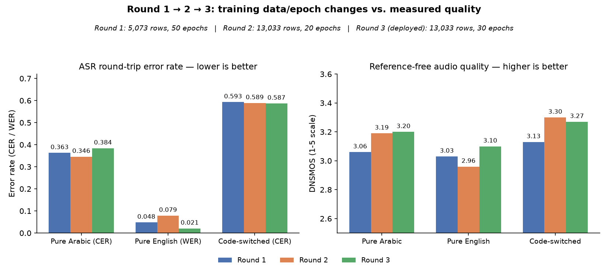

# HamsTTS — Levantine Arabic / English Code-Switching TTS

Fine-tuned from [`facebook/mms-tts-ara`](https://huggingface.co/facebook/mms-tts-ara)
(VITS architecture, 46.7M params) for low-latency streaming text-to-speech
spanning Levantine Arabic, English, and code-switching between them.
Built for Hams.AI. Code, the full design doc,
evaluation results, and sample audio all live in the GitHub repo (this
HF repo holds only the checkpoint + this card):
**[github.com/abkw/hams-tts](https://github.com/abkw/hams-tts)** — see
the [design doc](https://github.com/abkw/hams-tts/blob/main/docs/design_doc.md)
there for full methodology, benchmark results, and known limitations.

**License note:** `facebook/mms-tts-ara` (the base checkpoint) is licensed
CC BY-NC 4.0 (non-commercial) by Meta. This fine-tuned checkpoint inherits
that license.

## Model description

- **Architecture:** VITS (Conditional VAE + adversarial training,
  non-autoregressive, flow-based duration modeling).
- **Vocabulary:** custom 64-symbol phoneme inventory (not the base
  checkpoint's character-level Arabic vocabulary) — IPA-derived phonemes
  from espeak-ng, Levantine-corrected (ق→ʔ, ج→ʒ, dialect lexicon
  overrides), shared across Arabic and English, plus two
  Private-Use-Area marker codepoints for language conditioning.
- **Speakers:** 3 (one per training corpus — ClArTTS, Arabic Speech
  Corpus, LJSpeech), selectable via `speaker_id`.

## Intended use

Low-latency streaming TTS for Levantine-Arabic/English conversational
agents (voice assistants, IVR, accessibility tools) where natural
code-switching between the two languages is expected. Not intended for:
other Arabic dialects (Gulf, Maghrebi, Egyptian — pronunciation rules are
Levantine-specific), non-conversational/formal MSA narration (base MSA
pronunciation is intentionally overridden toward dialect), or any use
prohibited by the base checkpoint's CC BY-NC 4.0 non-commercial license.

## Training data

13,033 utterances: ClArTTS (9,460, MSA, diacritized — the full corpus),
Arabic Speech Corpus (1,873, Syrian-accented MSA — the full corpus),
LJSpeech (1,700, American English). No code-switched *audio* exists in
the training set — see the design doc's limitations section (linked
above) for why, and what that implies for code-switch quality.

**This is the third fine-tuning round.** Round 1 trained on a smaller
1,500-row slice of ClArTTS (~5,073 rows total, 50 epochs); round 2 moved
to the full ClArTTS corpus used here but at fewer epochs (20) to hold
training time roughly constant; round 3 (**this checkpoint**) keeps
round 2's full dataset but trains for more epochs (30) after real
listening feedback found round 2 under-converged on English specifically
while Arabic gains from the larger dataset held up. Full three-round
comparison: [design doc §4](https://github.com/abkw/hams-tts/blob/main/docs/design_doc.md#4-benchmark-results-vs-targets).

## How to use

This checkpoint uses a custom tokenizer vocabulary, not the standard MMS
character tokenizer — text must be pre-phonemized with this project's
own pipeline before tokenization (plain `pipeline("text-to-speech", ...)`
on raw Arabic/English text will **not** work correctly). Clone
[the repo](https://github.com/abkw/hams-tts) for the phonemization
pipeline (`hams_tts.text`) this depends on:

```python
import sys
sys.path.insert(0, "src")  # inside a clone of github.com/abkw/hams-tts

from hams_tts.inference.engine import Engine

engine = Engine(model_dir="<this checkpoint>", tokenizer_dir="<this checkpoint>")
audio, sampling_rate = engine.synthesize("بدي أروح ع meeting بكرا")
```

## Evaluation

Measured on an RTX 4070 Ti (12 GB) — the final cited hardware for this
project; no L4 access was available, and every margin below is wide
enough that the hardware choice isn't expected to flip a pass/fail.
Full methodology: [design doc §4](https://github.com/abkw/hams-tts/blob/main/docs/design_doc.md#4-benchmark-results-vs-targets) /
[eval_results.md](https://github.com/abkw/hams-tts/blob/main/docs/eval_results/eval_results.md).

**Latency/resource KPIs** (server-mode, end-to-end, 18 held-out utterances):

| Metric | Target | Measured (round 3) |
|---|---|---|
| TTFA p50 | < 300 ms | 51.3 ms |
| TTFA p95 | < 300 ms | 139.2 ms |
| RTF (mean) | < 0.3 | 0.023 |
| Peak VRAM | ≤ 3 GB | 1.05 GB |

All four pass with wide margin, consistently across all three training
rounds (inference architecture/precision never changed, only training
data/epochs did).

**ASR round-trip (faster-whisper large-v3) + DNSMOS** (reference-free
audio quality, 1-5, higher=better — not the same direction as CER/WER,
where lower=better), across all three training rounds:

| Category | R1 error rate | R1 DNSMOS | R2 error rate | R2 DNSMOS | R3 error rate (deployed) | R3 DNSMOS (deployed) |
|---|---|---|---|---|---|---|
| Pure Arabic | 0.363 CER | 3.06 | 0.346 CER | 3.19 | **0.384 CER** | **3.20** |
| Pure English | 0.048 WER | 3.03 | 0.079 WER | 2.96 | **0.021 WER** | **3.10** |
| Code-switched | 0.593 CER | 3.13 | 0.589 CER | 3.30 | **0.587 CER** | **3.27** |

**Data used per round:**

| Round | ClArTTS rows | ASC rows | LJSpeech rows | Total rows | Epochs |
|---|---|---|---|---|---|
| 1 | 1,500 | 1,873 | 1,700 | 5,073 | 50 |
| 2 | 9,460 (full) | 1,873 | 1,700 | 13,033 | 20 |
| 3 (deployed) | 9,460 (full) | 1,873 | 1,700 | 13,033 | 30 |



Arabic/code-switched CER is not low in absolute terms, and that's partly
real and partly a quirk of the metric: Whisper transcribes to *standard*
orthography, while this model deliberately speaks *Levantine*
pronunciation (ق→ʔ, dialect lexicon, etc.) that diverges from it by
design, so part of the "error" is the metric's reference being the wrong
ground truth, not the model mispronouncing.

**Confirmed by human listening, not just by these metrics** — and this
is where the concrete fixes in this project's history actually came
from, not just a caveat. Listening on round 2 surfaced two different
problems: (1) `mishkal` mis-diacritizing specific dialect words as
unrelated MSA words entirely (e.g. dialect عم → MSA عَمٌّ "uncle") — a
pure text-pipeline bug, fixed via 8 new lexicon entries in
`levantine_rules.py`, no retraining required; (2) a genuine model-level
confusion between ح/ʕ for at least one word ("مرحبا" heard as "مرعبا"
despite the phoneme pipeline correctly outputting /ħ/) — not fixable by
a lexicon entry, recorded as a known open limitation. Round 3 (more
epochs on the same full-corpus dataset) recovered English quality to its
best level across all three rounds while holding Arabic's round-2 gains;
Arabic DNSMOS itself barely moved round 2→3, suggesting the next lever
for further Arabic improvement is a different/additional corpus, not
more epochs on ClArTTS+ASC, both of which round 3 has now trained on
fairly thoroughly.

**Round 3 was confirmed as an improvement by direct listening, not just
by DNSMOS** — the project owner listened to round 3 against the same
samples and confirmed it sounds better than round 2. This checkpoint is
the final deployed result for this project, not a placeholder awaiting
further listening. Given the training scale here (13,033 utterances
across 2 Arabic speakers, no hyperparameter sweep) against production
Arabic TTS systems typically trained on hundreds of hours across many
speakers, intelligible-but-imperfect is a believable, expected result at
this scale, not a sign of a bug.

## Limitations

See [design doc §5](https://github.com/abkw/hams-tts/blob/main/docs/design_doc.md#5-known-limitations-and-what-more-time-would-buy)
for the full list. Headline items: no code-switched training audio;
language conditioning is token-level rather than a dedicated per-frame
embedding; Levantine lexicon overrides are exact-surface-form matches
(don't generalize across Arabic's clitic/prefix morphology).
